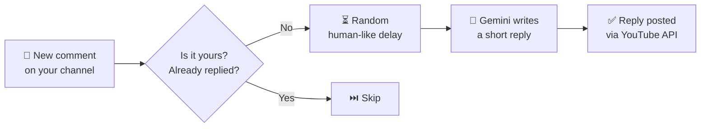

<div align="center">

# 🤖 YouTube Reply Bot

**Reads the comments on your YouTube channel and replies to them with AI, so you don't have to.**


[**⬇️ Download**](https://github.com/Emdysuji/YoutubeCommentBot/releases/latest) · [Quick start](#-quick-start) · [Configuration](#-configuration) · [Troubleshooting](#-troubleshooting)

</div>

---

> [!TIP]
> **The easiest way to use this bot is the ready-made app.** Download the **Windows `.exe`** or the **Linux binary** from the [Releases page](https://github.com/Emdysuji/YoutubeCommentBot/releases/latest). You don't need to install Python or write any code. You only fill in two small files and run it.
>
> Prefer to run it from source or build it yourself? See [Run from source](#-run-from-source) and [Build your own executable](#-build-your-own-executable).

## ✨ What it does



| | Feature |
|---|---|
| 🔄 | Checks for new comments on a schedule (default: every 60 seconds) |
| 🎯 | Works on your **whole channel** or on **one specific video** |
| 🧠 | Replies are written by **Google Gemini**, in the style you describe in the system prompt |
| 🙈 | Skips your own comments and comments you already replied to |
| 🛡️ | Safety limits: maximum replies per hour and a random delay before each reply |
| 💾 | Remembers its progress, so it never replies twice after a restart |
| 🔐 | One-time Google login, and after that it runs on its own |

---

## 🚀 Quick start

Use the **EXE (Windows)** or the **Linux binary** from the [latest release](https://github.com/Emdysuji/YoutubeCommentBot/releases/latest).

**1.** Create a folder, for example `YouTubeBot/`, and put the downloaded app in it.

**2.** Get your two credentials. Both are free and each takes about 5 minutes:
   - `client_secret.json` from Google Cloud ([how](#1-client_secretjson-youtube-login))
   - A Gemini API key from Google AI Studio ([how](#2-gemini-api-key))

**3.** Add `client_secret.json` and a `config.json` to the same folder. Start from [`config.example.json`](config.example.json). For `client_secret.json`, see [`client_secret.example.json`](client_secret.example.json) to check what the downloaded file should look like. Don't copy the sample. Download your real file from Google Cloud.

**4.** Your folder should now look like this:

```
YouTubeBot/
├── YouTube Reply Bot.exe     ← or "YouTube Reply Bot" on Linux
├── config.json               ← you create this
├── client_secret.json        ← you download this
│
├── token.json                ← auto-created on first login
├── state.json                ← auto-created (remembers progress)
└── bot.log                   ← auto-created (activity log)
```

**5.** Run it.

| Windows | Linux |
|---|---|
| Double-click `YouTube Reply Bot.exe` | `chmod +x "YouTube Reply Bot"` then `./"YouTube Reply Bot"` |

**6.** On the first run a browser window opens. Sign in with the YouTube account the bot should reply from and click **Allow**. You only do this once. After that, `token.json` is saved and the bot runs without asking again.

> [!NOTE]
> Windows or Google may warn you that the app is unverified. That's normal for a personal OAuth app. Click **Advanced → Continue**. It is your own app, using your own credentials.

To stop the bot, press `Ctrl + C` or close the window. It's safe to restart at any time.

---

## 🔑 Getting your credentials

### 1. `client_secret.json` (YouTube login)

1. Open the [Google Cloud Console](https://console.cloud.google.com/) and **create a new project**.
2. Go to **APIs & Services → Library**, search for **YouTube Data API v3** and click **Enable**.
3. Open the **OAuth consent screen** (also called *Google Auth Platform*) and set it up:
   - User type: **External**
   - Under **Test users**, **add your own Google email**
4. Go to **Credentials → Create credentials → OAuth client ID**.
5. Choose application type **Desktop app**. This matters, because other types won't work.
6. Click **Download JSON**, rename the file to **`client_secret.json`** and put it next to the app.

<details>
<summary><b>👀 What the file looks like (all values below are fake)</b></summary>

<br>

```json
{
  "installed": {
    "client_id": "123456789012-abcdefg.apps.googleusercontent.com",
    "project_id": "my-youtube-bot",
    "auth_uri": "https://accounts.google.com/o/oauth2/auth",
    "token_uri": "https://oauth2.googleapis.com/token",
    "auth_provider_x509_cert_url": "https://www.googleapis.com/oauth2/v1/certs",
    "client_secret": "GOCSPX-xxxxxxxxxxxxxxxxxxxx",
    "redirect_uris": ["http://localhost"]
  }
}
```

You don't edit this file. Just download it and don't change it. If the top-level key is `"web"` instead of `"installed"`, you picked the wrong application type in step 5.

</details>

> [!WARNING]
> While your Google app is in **Testing** status, Google expires the login after **7 days**. When that happens, delete `token.json` and run the bot again to sign in. To avoid this, publish the consent screen to production.

### 2. Gemini API key

1. Open [Google AI Studio](https://aistudio.google.com/apikey).
2. Click **Create API key** and copy it.
3. Paste it into `config.json` as the `api_key` value (see below).

---

## ⚙️ Configuration

Copy [`config.example.json`](config.example.json) to **`config.json`** and edit it:

```json
{
  "mode": "channel",
  "channel_id": "UCxxxxxxxxxxxxxxxxxxxxxx",
  "video_id": "",
  "poll_interval_seconds": 60,
  "max_replies_per_hour": 20,
  "reply_delay_seconds": [15, 60],

  "ai": {
    "provider": "Google",
    "api_key": "YOUR_GEMINI_API_KEY",
    "model": "gemini-2.5-flash",
    "system_prompt": "You are a YouTube creator replying to comments. Keep replies short, friendly and human."
  }
}
```

| Setting | What it does | Example |
|---|---|---|
| `mode` | `"channel"` replies on your whole channel, `"video"` replies on one video only | `"channel"` |
| `channel_id` | Your channel ID. Only used in `channel` mode. It starts with `UC`. Find it in YouTube Studio → Settings → Channel → Advanced settings | `"UC1a2b3c…"` |
| `video_id` | The video ID. Only used in `video` mode. It's the part after `v=` in the video's URL | `"dQw4w9WgXcQ"` |
| `poll_interval_seconds` | How often the bot looks for new comments | `60` |
| `max_replies_per_hour` | Safety cap on replies per hour | `20` |
| `reply_delay_seconds` | Random wait `[min, max]` before each reply, so it looks natural | `[15, 60]` |
| `ai.api_key` | Your Gemini API key | `"AIza…"` |
| `ai.model` | The Gemini model that writes replies | `"gemini-2.5-flash"` |
| `ai.system_prompt` | Tells the AI how to reply (tone, length, language) | see above |

> [!TIP]
> **The system prompt controls everything about the voice of your replies.** Want replies in another language, more formal, funnier or shorter? Change this one line.

> [!CAUTION]
> **Never share or upload your real `config.json`, `client_secret.json` or `token.json`.** They contain your private keys. This repo's `.gitignore` already keeps the secret files out of Git.

---

## 🐍 Run from source

For developers, or if you'd rather not use the prebuilt app.

```bash
git clone https://github.com/Emdysuji/YoutubeCommentBot.git
cd YoutubeCommentBot

python -m venv .venv
# Windows:  .venv\Scripts\activate
# Linux:    source .venv/bin/activate

pip install -r requirements.txt
```

Add your `config.json` and `client_secret.json` to the project folder (see [Configuration](#-configuration)), then run:

```bash
python yt_bot.py
```

---

## 📦 Build your own executable

The app is packaged with [PyInstaller](https://pyinstaller.org). **PyInstaller can't cross-compile.** Build the Windows `.exe` on Windows and the Linux binary on Linux (WSL works).

```bash
pip install -r requirements.txt

pyinstaller --onefile --console --name "YouTube Reply Bot" yt_bot.py
```

| Platform | Output |
|---|---|
| Windows | `dist\YouTube Reply Bot.exe` |
| Linux | `dist/YouTube Reply Bot` (run `chmod +x` on it) |

<details>
<summary><b>The build fails or the app crashes with a "ModuleNotFoundError"</b></summary>

<br>

Rebuild with the extra Google packages included:

```bash
pyinstaller --onefile --console --name "YouTube Reply Bot" \
  --collect-all google.genai \
  --collect-data googleapiclient \
  yt_bot.py
```

(On Windows PowerShell, put the command on one line instead of using `\`.)

</details>

The build also creates `build/`, `dist/` and a `.spec` file. This repo already includes `YouTube Reply Bot.spec`, so you can rebuild with `pyinstaller "YouTube Reply Bot.spec"`.

> [!NOTE]
> The built app does **not** contain your secrets. It reads `config.json` and `client_secret.json` from the folder it sits in, so you can share the app without sharing your keys.

**Linux on a server with no browser?** The first login needs a browser. Run the bot once on your own computer, sign in, then copy the generated `token.json` to the server, next to the binary.

---

## 📊 Limits to know about

- **YouTube API quota:** a new Google Cloud project gets **10,000 units per day**. Reading comments costs 1 unit per check, and **posting a reply costs 50 units**. In practice that's roughly **150–190 replies a day** at the default settings. Free quota resets daily.
- **Gemini API:** the free tier has its own rate limits, so check your limits in Google AI Studio.
- **Be a good citizen:** keep `max_replies_per_hour` modest and follow [YouTube's policies](https://www.youtube.com/t/terms) on automated activity and spam.

---

## 🩺 Troubleshooting

| Problem | Likely cause and fix |
|---|---|
| Window closes immediately | Missing or misnamed `client_secret.json` or `config.json`. Run it from a terminal to see the error. |
| `License validation failed` | The app couldn't reach its license check. Check your internet connection, or contact the developer. |
| Browser login shows "access blocked" | Add your Google account under **Test users** on the OAuth consent screen. |
| Had to log in again after a week | Your Google app is in *Testing* status. Delete `token.json`, run again, or publish the app. |
| Bot runs but never replies | No new comments, the hourly limit was reached, or you already replied to them. Check `bot.log`. |
| Replies fail with a quota error | You used your daily YouTube API quota. It resets daily. |
| Gemini errors in `bot.log` | Check that `ai.api_key` and `ai.model` are correct. |
| `403` error mentioning the API is "not enabled" | Make sure **YouTube Data API v3** is enabled in the same Google Cloud project as your `client_secret.json`. |

The activity log is saved in **`bot.log`** next to the app. Check it first when something goes wrong.

---

## 🗂️ Project files

| File | Purpose |
|---|---|
| `yt_bot.py` | The bot itself (this is what the EXE is built from) |
| `cli.py` | Colored terminal output |
| `config.example.json` | Template for your `config.json` |
| `requirements.txt` | Python dependencies |
| `YouTube Reply Bot.spec` | PyInstaller build settings |
| `Dockerfile` | Container setup |
| `main.py`, `test_yt.py`, `testing_id.py`, `youtube_comment_bot.py` | Experiments and test scripts |

---

## ⚠️ Disclaimer

This tool replies on your behalf using AI. You are responsible for the replies it posts, so review the output, keep the limits sensible, and make sure your use complies with YouTube's Terms of Service and local law. Provided as is, without warranty.

<div align="center">

**If this helped you, consider giving the repo a ⭐**

</div>
